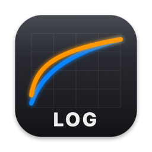
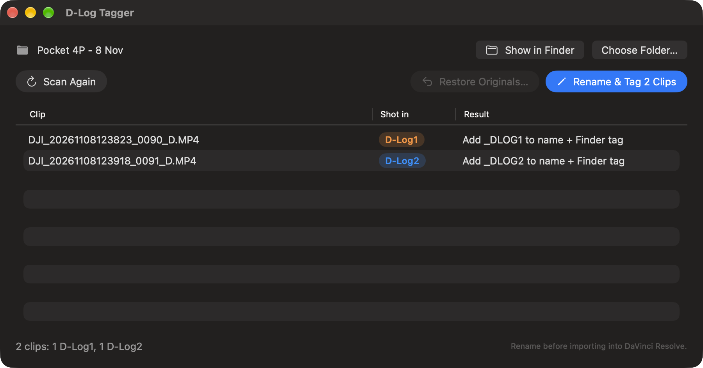

<p align="center">
  
</p>

<h1 align="center">D-Log Tagger</h1>

<p align="center">
  See which DJI log profile each clip was shot in — <b>before</b> you start grading in DaVinci Resolve.
</p>

<p align="center">
  
</p>

## The problem

The DJI Osmo Pocket 4P can shoot in two log profiles, **D-Log1** and **D-Log2**, and they need different
transforms/LUTs. But the filenames are identical (`DJI_…_D.MP4`) and DaVinci Resolve doesn't show which
profile a clip used — so you end up guessing from the waveform.

The camera *does* record the profile inside every file. D-Log Tagger reads it and makes it visible:

- **Renames** each clip: `DJI_20261108123823_0090_D.MP4` → `DJI_20261108123823_0090_D_DLOG1.MP4`
  (so it's obvious in Resolve's Media Pool too)
- **Adds a Finder tag**: orange **D-Log1** or blue **D-Log2** — sortable in list view, and clickable in
  the Finder sidebar to see every clip of that type

It only reads a few kilobytes of metadata per clip, so even a full card is checked in a second or two. Video
data is never modified.

## Mac app

### Install

1. Download **`DLogTagger-x.y.z-macOS.zip`** from the
   [latest release](https://github.com/granthorner-1980/dlog-tagger/releases/latest).
2. Double-click the zip, then drag **D-Log Tagger** into your **Applications** folder.
3. **First launch only:** the app isn't notarised by Apple yet, so macOS will say it can't verify it.
   Click **Done**, open **System Settings → Privacy & Security**, scroll down and click **Open Anyway**
   next to "D-Log Tagger", then confirm. After that it opens normally.

Requires macOS 14 Sonoma or later. Runs natively on Apple Silicon and Intel.

<details>
<summary><b>Or build it yourself</b> (no security prompt)</summary>

Apps you build on your own Mac open without the warning. It's one command and takes about a minute:

```bash
xcode-select --install          # only if you don't have Xcode or its Command Line Tools
git clone https://github.com/granthorner-1980/dlog-tagger.git
cd dlog-tagger/mac
./build.sh --install            # builds and copies it to ~/Applications
```

`./build.sh --zip` makes the release zip instead.
</details>

### Use

1. **Choose Folder…** — pick the folder you offloaded your clips into. The list fills in straight away
   (subfolders are included).
2. Check the **Shot in** column.
3. **Rename & Tag**.

Clips that are already renamed and tagged are skipped, so it's safe to run on the same folder again.
Clips it doesn't recognise (e.g. normal-colour footage) are left untouched.

**Show in Finder** opens the folder. Double-click a clip (or right-click → Show in Finder) to open Finder with
that file selected.

**Changed your mind?**

- **Undo** (or **⌘Z**) straight after Rename & Tag reverses exactly what it just did.
- **Restore Originals…** puts every clip in the folder back to its original name and removes the D-Log
  tags — any time, even for clips renamed weeks ago. Your own Finder tags are kept, and a clip is skipped
  (not half-changed) if a file with its original name already exists.

> **Tip:** rename *before* importing into Resolve. Renaming files that are already in a Resolve project
> means you'll have to relink them.

## Command-line version (Mac, Windows, Linux)

[`python/dlog_offload.py`](python/dlog_offload.py) does the same detection with nothing but Python 3 —
handy on Windows, or for copying straight off the card. It renames but doesn't add Finder tags.

```bash
# copy clips off the card into a folder, adding _DLOG1/_DLOG2 to the names (card left untouched)
python3 dlog_offload.py /Volumes/SD_CARD ~/Footage/2026-11-08

# rename clips that are already on your computer
python3 dlog_offload.py --in-place ~/Footage/2026-11-08

# preview without changing anything
python3 dlog_offload.py --dry-run /Volumes/SD_CARD ~/Footage/2026-11-08
```

## How it works

DJI cameras write their settings into each MP4 in two places, and D-Log Tagger checks both:

| Where | What it is | D-Log1 | D-Log2 |
|---|---|---|---|
| `moov/udta/dbcm` | 4-byte value in the file header | `5` | `2` |
| `djmd` metadata track | Protobuf field `2.2.3.1` in the first frame (`dvtm_osmo_pocket_4.proto`) | `22` | `2` |

If the two disagree, or a value isn't in the table, the clip is left alone rather than guessed.

These values were worked out from real clips; DJI doesn't document them.

## Supported cameras

| Camera | Status |
|---|---|
| DJI Osmo Pocket 4P | ✅ Tested (D-Log1, D-Log2) |
| Other DJI cameras | ❓ Unknown — they may use different values. Help add yours ↓ |

### Add your camera

If your clips show up as **Unknown**, the app needs to learn your camera's values. Shoot a short clip in each
log mode, then run:

```bash
"/Applications/D-Log Tagger.app/Contents/MacOS/DLogTagger" --detect /path/to/clip1.MP4 /path/to/clip2.MP4
```

It prints a line per clip like `UNKNOWN  dbcm=5  djmd=22  …`. [Open an issue](https://github.com/granthorner-1980/dlog-tagger/issues/new)
with that output, your camera model, and which clip was which mode. A normal-colour clip helps too, to make
sure it's never mistaken for log.

## Project layout

```
mac/        SwiftUI app — main.swift (everything), build.sh, make_icon.swift (draws the icon)
python/     dlog_offload.py — cross-platform command-line version
docs/       README images
```

No Xcode project needed: `mac/build.sh` compiles `main.swift` with `swiftc` and assembles the `.app`.

Releasing a new version: see [RELEASING.md](RELEASING.md) (one click in GitHub Actions).

## License

[MIT](LICENSE) © 2026 Grant Horner

Not affiliated with or endorsed by DJI or Blackmagic Design. "DJI", "Osmo", "D-Log" and "DaVinci Resolve"
are trademarks of their respective owners.
